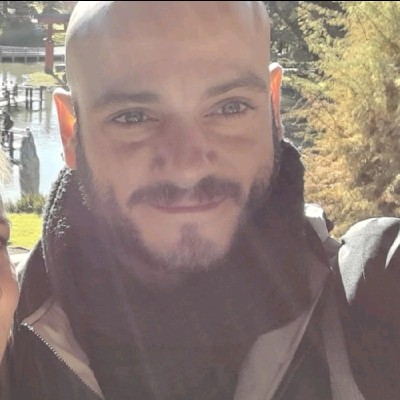

# Juan Ignacio Martínez · Development Portfolio

I'm an industrial automation, AI, and robotics engineer with more than 20 years of systems integration experience. I build systems that connect cameras, PLCs, and robots to inspection applications, operator interfaces, and analytics tools.

Featured projects include [particle inspection](projects/particle-inspection/), [weld inspection](projects/weld-inspection/), [web SCADA](projects/web-scada/), and the [Android detector builder](projects/android-detector-builder/).

Each project page includes a runnable demo and setup instructions. The industrial demos use simulated equipment and sample data.

## Industrial Integration and Commissioning

| Project | My Contribution | Technologies |
| --- | --- | --- |
| **[Automated Cold-Storage Warehouse](projects/automated-cold-storage-warehouse/)** | Developed and commissioned the PLC controls that coordinate freezing, pallet handling, and automated storage. Integrated supervisory software over OPC and the stacker crane over an industrial radio link. | Siemens S7-1500, TIA Portal, OPC, SINAMICS |
| **[Robotic Laboratory Integration](projects/robotic-laboratory-integration/)** | Integrated FANUC sample handling with lab instruments and developed C++ interfaces on QNX to exchange data with plant SCADA and production systems. | FANUC, C++, QNX, SCADA, OES/XRF |
| **[Robotic Painting Cell and Digital Twin](projects/robotic-painting-digital-twin/)** | Programmed and helped commission a two-robot KUKA painting cell. Integrated Schneider controls and used a RoboDK digital twin to evaluate trajectories and product flow. | KUKA KRC4, Schneider PLC/HMI, RoboDK, Python |

## Machine Vision and Industrial Automation

| Project | What I Built | Technologies |
| --- | --- | --- |
| **[Particle and Bubble Inspection](projects/particle-inspection/)** | Inspects particles and bubbles using segmentation and tracking. Supports mask previews, configurable profiles, and batch processing across images, video, and live camera feeds. | Python, OpenCV, NumPy, YOLO11 |
| **[Weld Inspection](projects/weld-inspection/)** | Tracks weld seams using intensity profiles. A separate implementation uses a TCP bridge to connect 32-bit LabVIEW to a YOLOv5 detector running in 64-bit Python. | Python, OpenCV, YOLOv5, LabVIEW, TCP |
| **[Web SCADA and Industrial Interface](projects/web-scada/)** | Connects to or simulates a Siemens S7 PLC and manages signals, alarms, and historical data. A modular web interface integrates dashboards and vision services. | Python, FastAPI, WebSocket, SQLite, python-snap7, React, Flask |
| **[Visual Inspection, OCR, and Code Reading](projects/visual-inspection-ocr/)** | Combines object detection, OCR, and code reading in video and shows the results in an inspection interface. | Python, OpenCV, YOLOv5, Tesseract, pyzbar |

## Applied AI and Devices

| Project | What I Built | Technologies |
| --- | --- | --- |
| **[Android Detector Builder](projects/android-detector-builder/)** | Builds one Android APK per pretrained NCNN model. Validates a manifest and packages model files, labels, and metadata into an existing detection template. | Python, Android, Gradle, NCNN |
| **[Local Vision Assistant](projects/local-vision-assistant/)** | Lets users ask about webcam images in natural language. One prototype uses Gradio and GGUF models, and another uses Qwen2-VL with Transformers. | Python, OpenCV, Gradio, llama.cpp, Transformers |
| **[Hybrid Municipal Chatbot](projects/municipal-chatbot/)** | Combines rules, FAQ retrieval, and a language model. The portal supports per-chatbot rules, suggestions, and settings. | Python, FastAPI, Pydantic, JavaScript |

## Cameras, Robotics, and Telemetry

| Project | What I Built | Technologies |
| --- | --- | --- |
| **[PTZ Camera Control with WebXR](projects/webxr-ptz-camera/)** | Provides live video, camera presets, and text controls on desktop. A Meta Quest prototype brings video and camera control into an immersive session. | Python, OpenCV, ONVIF, RTSP, Node.js, FFmpeg, WebXR |
| **[Gesture-Controlled Robotics in RoboDK](projects/gesture-controlled-robotics/)** | Turns hand movements captured by a webcam into tool and gripper movements in a simulated robot cell. | Python, MediaPipe, OpenCV, RoboDK |
| **[Three-Phase Energy Monitoring](projects/three-phase-energy-monitoring/)** | Logs readings from a three-phase solar power meter over Modbus. Includes an MQTT subscriber and a forecasting notebook. | Python, Modbus, MQTT, pandas, Jupyter |

## Web Development

| Project | What I Built | Technologies |
| --- | --- | --- |
| **[IA Software Project Website](projects/ia-software-website/)** | A multilingual website showcasing automation, robotics, and computer vision through case studies and 3D demonstrations. | HTML, CSS, JavaScript, Three.js |

## About Me

I'm based in Rosario, Argentina. My experience includes commissioning PLC and SCADA systems, integrating IT and OT on the plant floor, developing industrial robotics solutions, and applying computer vision to quality control.

[LinkedIn · Juan Ignacio Martínez](https://www.linkedin.com/in/juan-ignacio-martinez-2a6a9223/)
