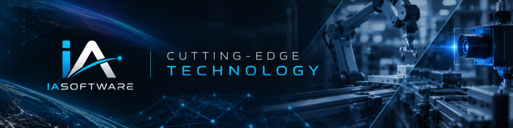

# PTZ Camera Control with WebXR

Desktop application and WebXR prototype

## Objective

View and steer a PTZ camera from a desktop application and explore control in an immersive interface.

## Implementation

The desktop client displays RTSP video, saves camera presets, and translates text instructions into camera operations. The Meta Quest prototype uses Node.js, FFmpeg, and ONVIF to stream video to the browser and handle movement commands.

## Technologies

Python, OpenCV, ONVIF, RTSP, Node.js, FFmpeg, WebXR.

[Back to the portfolio](../../README.md)
